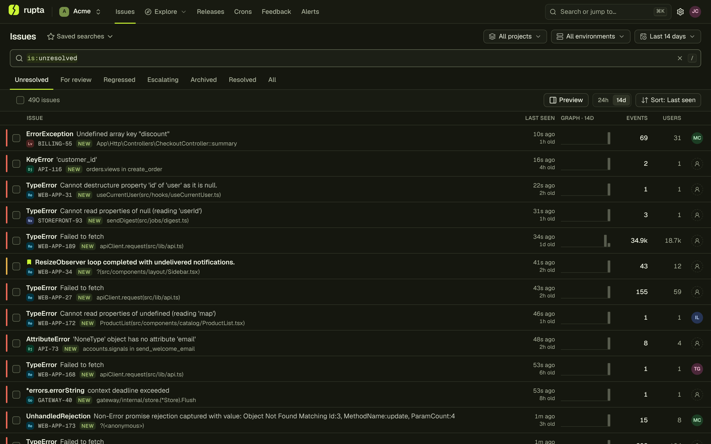
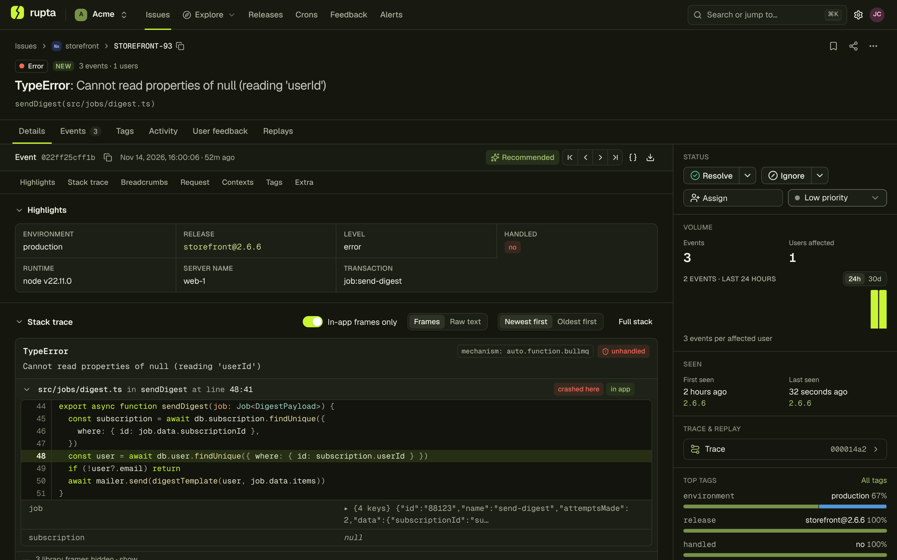
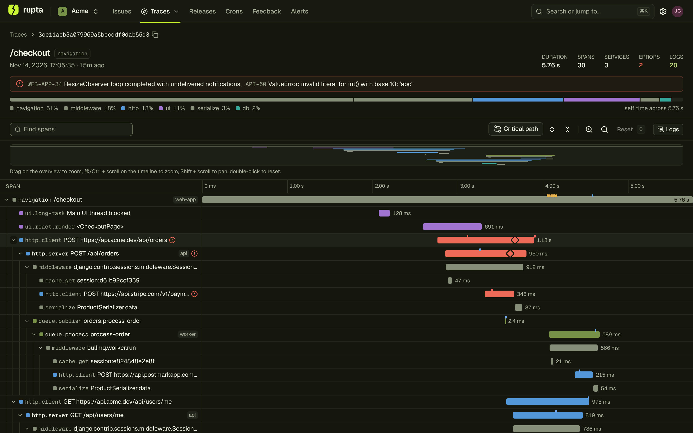
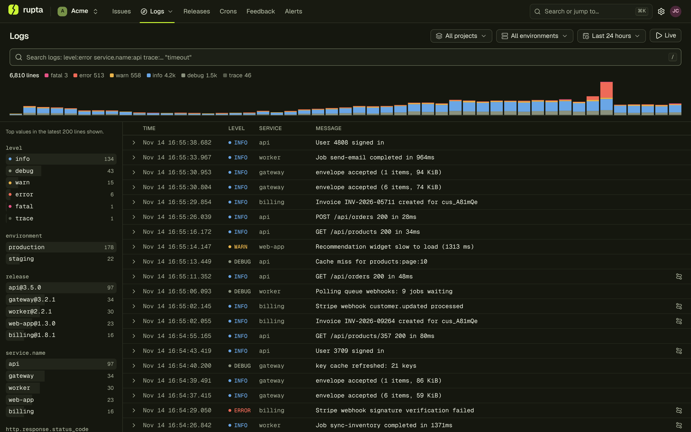
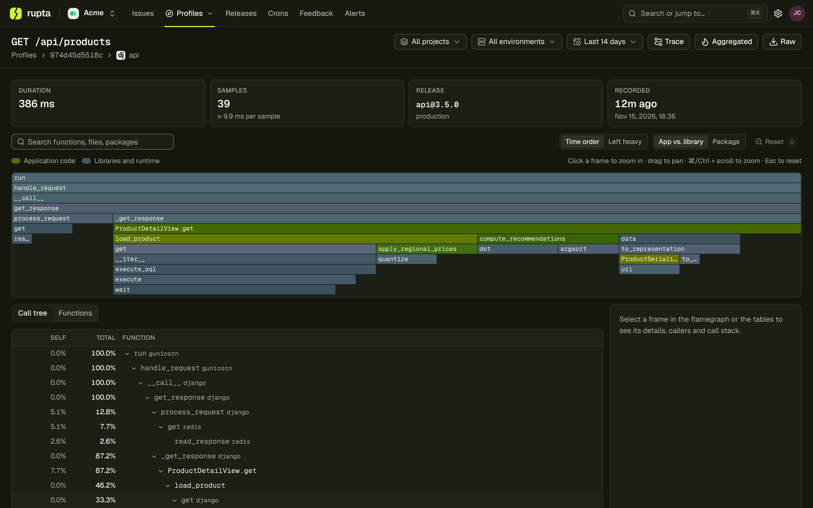
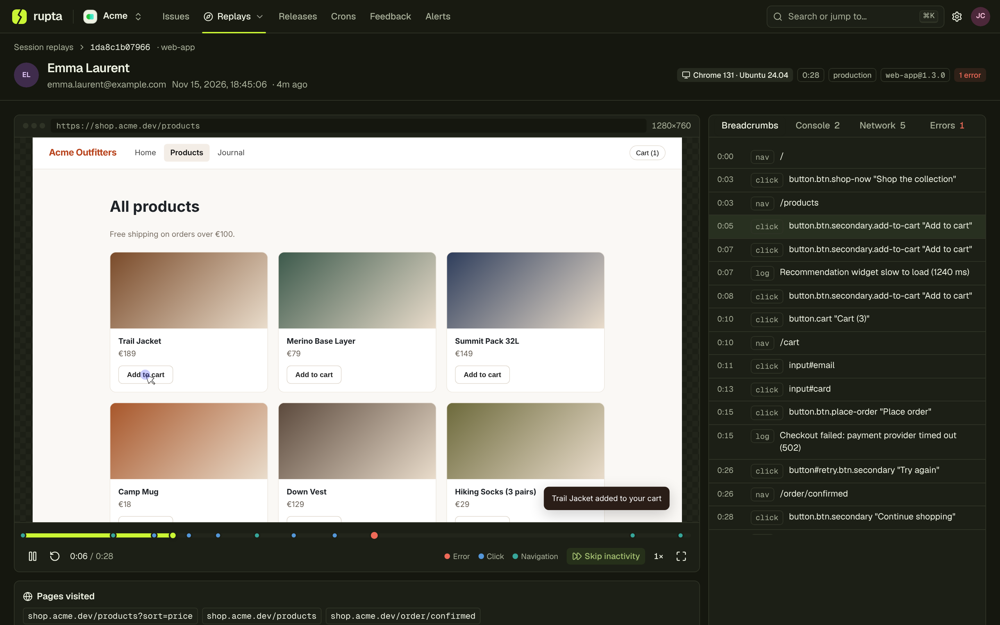

<p align="center">
  
</p>

<h1 align="center">rupta</h1>

<p align="center">
  <strong>Self-hosted error tracking and application monitoring in a single container.</strong><br>
  Works with the Sentry SDKs and <code>sentry-cli</code>: switch an existing app by changing its DSN.<br>
  Built in Rust on an embedded database.
</p>

<p align="center">
  <a href="https://github.com/michaeldoehler/rupta/actions/workflows/ci.yml"></a>
  <a href="LICENSE"></a>
</p>



rupta (from *rupture*) collects errors, traces, logs, metrics, profiles and
session replays from your applications, groups errors into issues and
alerts your team.

**Which SDKs?** rupta implements the ingestion protocol of the **Sentry
SDKs**, the open-source client libraries that Sentry publishes for each
platform (`@sentry/browser`, `@sentry/node`, `@sentry/react`,
`@sentry/nextjs`, `sentry/sentry`, `sentry/sentry-laravel` and
`sentry/sentry-symfony` for PHP,
`sentry-sdk` for Python, and the SDKs for Go, Java, .NET, Ruby, Rust and
others), and the source map upload commands of **`sentry-cli`**. You do
not install anything from rupta in your application: you keep using these
SDKs unchanged, and an application that already reports to Sentry switches
to rupta by changing its DSN. The JavaScript (browser and Node.js), PHP and
Python SDKs are tested end to end; the others use the same protocol and
are expected to work. The [compatibility matrix](docs/sdk-compatibility.md#compatibility-matrix)
lists every data type per SDK, and what is not supported.

> Sentry is a trademark of Functional Software, Inc. rupta is an
> independent project and is not affiliated with or endorsed by Sentry.

It runs as **one process** — HTTP API, ingestion pipeline, web app and
database in a single binary — and keeps its durable copy in any
S3-compatible bucket such as [Garage](https://garagehq.deuxfleurs.fr). No
Kafka, no ClickHouse, no Redis, no PostgreSQL to operate.

> **Status: 0.1.** The first public release. It has an extensive test suite,
> including end-to-end tests with the real SDKs, but it has not yet run in
> large production deployments. See [what is supported](docs/sdk-compatibility.md)
> and the [limits](#limits).

## Features

- **Error tracking.** Issues with stack traces, source context, chained
  exceptions, breadcrumbs, request data, contexts, tag distributions,
  release and environment, user impact, comments and assignment. Grouping
  by fingerprint, exception and in-app frames, with regression and
  escalation detection. → [grouping](docs/grouping.md)
- **JavaScript source maps** uploaded with `sentry-cli` or the bundler
  plugins that use it (debug ids or release artifacts).
  → [source maps](docs/sourcemaps.md)
- **Performance.** Transactions with throughput, latency percentiles,
  failure rate, Apdex and Web Vitals; trace waterfall; span explorer.
  → [performance](docs/performance.md)
- **Logs** with search, facets and live tail, linked to traces and issues.
  → [logs](docs/logs.md)
- **Metrics** explorer and dashboards. → [metrics](docs/metrics.md)
- **Profiling** with flamegraphs per profile and aggregated per
  transaction. → [profiling](docs/profiling.md)
- **Session replay** of browser sessions, linked to the errors they
  contain. → [session replay](docs/session-replay.md)
- **Release health** (crash-free sessions and users), **cron monitoring**
  and **user feedback**.
- **Alerts** by email, Slack, Microsoft Teams, signed webhooks, PagerDuty
  and Opsgenie. → [alerts](docs/alerts.md)
- **Issue tracker integrations**: create or link Jira (Cloud and Data
  Center), Linear, GitHub and GitLab tickets, with two-way status sync.
  → [integrations](docs/integrations.md)
- **Prometheus metrics**, alert rules and a Grafana dashboard.
  → [monitoring](docs/monitoring.md)
- **Enterprise-ready access control.** Single sign-on with OpenID Connect
  (Zitadel, Keycloak, Entra ID, Okta, …) with role mapping and
  per-organization enforcement, organizations, teams, four roles, scoped
  API tokens, audit log. → [single sign-on](docs/sso.md),
  [authentication](docs/authentication.md)
- **Privacy.** Server-side scrubbing of passwords, tokens, cookies and card
  numbers, inbound filters, per-project retention and sampling.
  → [data scrubbing](docs/data-scrubbing.md)
- **A complete REST API** with an OpenAPI 3.1 description.
  → [API](docs/api.md)
- **Fast.** Ingestion acknowledges tens of thousands of events per second
  and stores about 10,000 per second on four cores; issue lists and
  aggregations over a million rows answer in milliseconds.
  → [ingestion](docs/ingestion.md)



<table>
  <tr>
    <td></td>
    <td></td>
  </tr>
  <tr>
    <td></td>
    <td></td>
  </tr>
</table>

## Quick start

With Docker Compose (rupta plus a single-node Garage for durable storage):

```sh
git clone https://github.com/michaeldoehler/rupta && cd rupta
scripts/generate-env.sh http://localhost:8080   # writes .env with random secrets, prints the admin password
docker compose up -d
```

Open <http://localhost:8080>, log in as `admin@example.com` with the
printed password, create a project (*Settings → Projects → New project*)
and copy its DSN. [Getting started](docs/getting-started.md) walks through
the first five minutes, including a test error sent with `curl`.

Without Garage, for a quick look:

```sh
docker run -d -p 8080:8080 -v rupta-data:/data \
  -e RUPTA_SECRET_KEY=$(openssl rand -hex 32) \
  ghcr.io/michaeldoehler/rupta:0.1.0
```

The first visitor then creates the administrator account in the setup
screen. Without a bucket, the volume is the only copy of the data.

## Send your first error

Install the Sentry SDK for your platform and initialize it with the DSN
from the project settings. For a browser application:

```sh
npm install @sentry/browser
```

```js
import * as Sentry from "@sentry/browser";

Sentry.init({
  dsn: "http://<public-key>@localhost:8080/<project-id>",
  release: "my-app@1.0.0",
  tracesSampleRate: 1.0,
});
```

The DSN has the form `http(s)://<public key>@<host>/<project id>`; the
SDK derives the ingest URL (`/api/<project id>/envelope/`) from it.

**Already using Sentry?** Replace the DSN in your configuration (often the
`SENTRY_DSN` environment variable) with the one from rupta and redeploy.
Nothing else in the application changes. To keep uploading source maps,
point `sentry-cli` at rupta with `SENTRY_URL` and a rupta token
([source map upload](docs/sourcemap-upload.md)).

The project settings show copy-paste setup for 14 platforms (JavaScript,
React, Next.js, Node.js, PHP, Laravel, Symfony, Python, Django, Go, Java,
.NET, Ruby and Rust); [getting started](docs/getting-started.md#3-send-errors-from-your-application)
has the snippets for JavaScript, Node.js, PHP, Laravel, Python and Django.
→ [SDK compatibility](docs/sdk-compatibility.md)

## Documentation

Start with [getting started](docs/getting-started.md); the
[documentation index](docs/README.md) suggests a reading order.

| | |
| --- | --- |
| [Getting started](docs/getting-started.md) | from zero to the first error in a few minutes |
| [Deployment](docs/deployment.md) | Docker Compose, Docker Swarm, Garage and S3, TLS, sizing |
| [Configuration](docs/configuration.md) | every environment variable |
| [Operations](docs/operations.md) | health checks, metrics, backup and restore, upgrades, troubleshooting |
| [Monitoring](docs/monitoring.md) | Prometheus metrics, alert rules, Grafana dashboard and annotations |
| [User guide](docs/user-guide.md) | a tour of the web app, keyboard shortcuts |
| [SDK compatibility](docs/sdk-compatibility.md) | which Sentry SDKs and data types work, tested versions, what is not supported |
| [Search](docs/search.md) | the query language |
| [Single sign-on](docs/sso.md) | OpenID Connect, step by step with Zitadel |
| [Authentication](docs/authentication.md) | accounts, sessions, roles, API tokens |
| [Alerts](docs/alerts.md) | rules, conditions, notification channels |
| [Integrations](docs/integrations.md) | Jira, Linear, GitHub and GitLab tickets and status sync |
| [Source maps](docs/sourcemaps.md), [upload](docs/sourcemap-upload.md) | symbolication, and uploading with `sentry-cli` |
| [Performance](docs/performance.md), [Logs](docs/logs.md), [Metrics](docs/metrics.md), [Profiling](docs/profiling.md), [Session replay](docs/session-replay.md) | the monitoring features |
| [Ingestion](docs/ingestion.md), [Grouping](docs/grouping.md), [Data scrubbing](docs/data-scrubbing.md) | how events are processed |
| [API](docs/api.md) | REST API overview; [OpenAPI](docs/api/openapi.json) |
| [Architecture](docs/architecture.md) | the parts and the reasons behind them |
| [Security](docs/security.md) | threat model and hardening |
| [Comparison](docs/comparison.md) | rupta compared with other self-hosted options |

## Limits

- One writer per instance: rupta scales up, not out. Run separate
  instances for separate tenants or regions.
- Percentiles are approximate. Replay recordings are not scrubbed on the
  server; mask sensitive content in the SDK (the default).
- Not yet available: SAML and SCIM, native (mobile and desktop) crash
  reports and minidumps, mobile session replay, source maps for profile
  frames, automatic failover beyond rescheduling.

Each chapter lists the limits of its feature.

## Development

See [CONTRIBUTING.md](CONTRIBUTING.md). In short:

```sh
RUPTA_SECRET_KEY=$(openssl rand -hex 32) RUPTA_DATA_DIR=./data cargo run -p rupta-server
pnpm --dir web install && pnpm --dir web dev      # http://localhost:5173
```

## License

MIT. See [LICENSE](LICENSE).

Sentry is a trademark of Functional Software, Inc. rupta is an independent
project and is not affiliated with or endorsed by Sentry. rupta is written
independently of the Sentry server; it implements the protocol that the
open-source Sentry SDKs speak.
