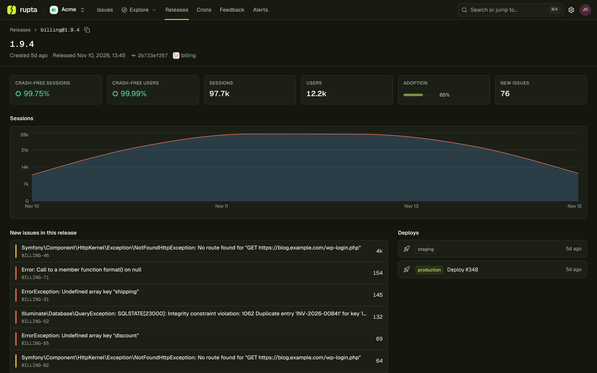
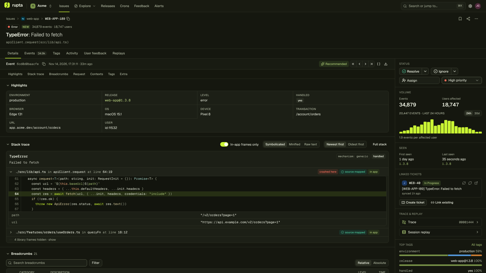
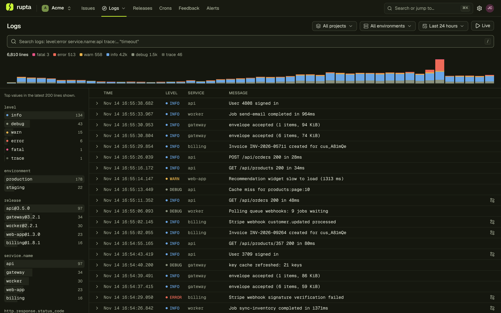
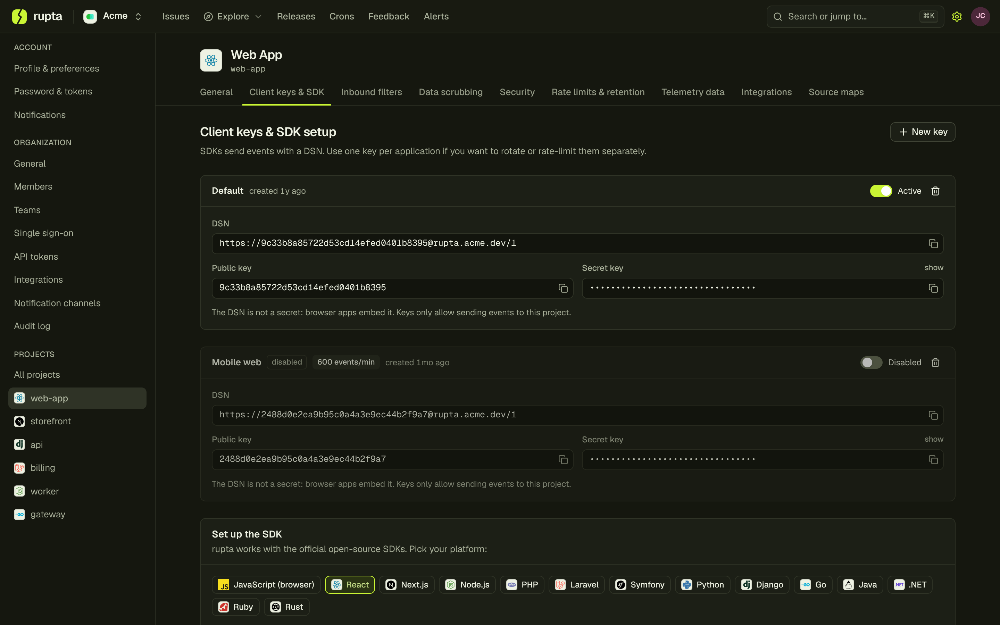
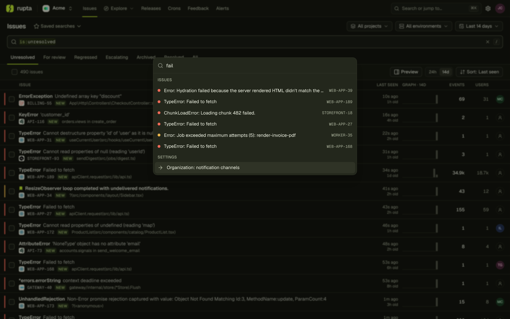

# User guide

A tour of the rupta web app: where things are, how to triage issues
quickly, how to read traces, logs, metrics, profiles and session replays,
the search syntax and the keyboard shortcuts.

## Signing in

- **First start.** When the database has no users and no bootstrap
  administrator is configured, the app opens a setup wizard: your account
  (name, email, password of at least 10 characters), then the name of your
  organization.
- **Sign in.** The login page offers email and password (unless the server
  disables it) and a button for each single sign-on provider the server
  lists. If an organization requires single sign-on, signing in with a
  password sends you to its provider instead. Add `?org=<slug>` to the
  login URL to see an organization's own provider.
- **Invitations.** Invitation links open `/accept-invite/<token>`. New
  people choose a name and password; people who already have an account
  accept while signed in. When the server cannot send email, the person
  who invited gets the link to pass on.

## Layout

rupta has one dark theme. The bar at the top holds the logo and the
organization switcher, the main sections (**Issues**; **Explore** with
**Performance**, **Traces**, **Logs**, **Metrics**, **Dashboards**,
**Profiles** and **Replays**; **Releases**, **Crons**, **Feedback** and
**Alerts**), and on the right the search field for the command palette
(`⌘K`), **Settings** and your account menu (shortcuts, sign out). The
current section is underlined. On narrow screens the sections open from
the menu button.

List pages share three selectors at the top: **projects**, **environments**
and **period**. They are part of the URL, so a link you copy opens the same
view, and they stay set while you move between pages. The Explore pages
also offer **Last hour**.

## Issues

The stream lists issues grouped from events. Each row shows the level
(coloured bar), the error type and message, the project, the short id, a
status badge (New, Regressed, Escalating, Resolved, Ignored), the culprit,
when it was last and first seen, a bar chart of events over the selected
period, the event and user counts, and the assignee.

- **Tabs** switch the status part of the search: Unresolved, For review
  (new, untriaged issues), Regressed, Escalating, Archived (ignored),
  Resolved and All.
- **Period.** The period selector (or the 24h/14d switch above the list)
  limits the list to issues seen in that period and sets the range of the
  row charts: hourly bars up to 48 hours, daily bars beyond.
- **Sort** by last seen, first seen, events, users or priority.
- **Saved searches** keep a query and sort under a name, for you or shared
  with the organization.
- **Bulk actions.** Select rows with the checkboxes (shift-click selects a
  range) to resolve, ignore (until it escalates, forever, for a time, or
  until it happens a number of times again), assign, bookmark, mark
  reviewed or delete them. Changes show immediately and are undone if the
  server refuses them; resolving and ignoring offer **Undo** in the
  notification.
- **Live updates.** While the page is visible it checks for changes every
  30 seconds. Counts and charts of the listed issues update in place; when
  new issues arrive, a bar above the list offers to show them, so the list
  never jumps while you work.

The list is virtualised: only the visible rows exist in the page, so it
stays fast with tens of thousands of issues. More rows load as you scroll.

**Preview.** On screens at least 1440 pixels wide, **Preview** shows the
focused issue next to the list: its summary, resolve and ignore buttons,
the event chart and the recommended event with stack trace. `j`/`k` move
through the list and update the preview, a click previews, `Enter` (or
⌘-click) opens the full page. The choice is remembered in the browser.

Resolving in the next release marks the issue resolved until a newer
release appears; ignoring "until it affects" N more users counts users
since you ignored it.

## Issue details

The header shows level, status, counts, title and culprit, a bookmark, a
link to copy and a menu (copy as text or Markdown, create or link a ticket,
delete). The page has two
columns: the tabs below on the left, and a context panel on the right that
stays in view while you scroll (below the header on narrow screens):

- **Status:** resolve (now, in the next release, in the current release),
  ignore, assign and priority.
- **Volume:** events and affected users with a chart of the last 24 hours
  or 30 days.
- **Seen:** first and last seen with their releases.
- **Linked tickets:** tickets in a connected issue tracker (Jira, Linear,
  GitHub, GitLab) with their key, status, assignee and when rupta last read
  them. **Refresh** reads a ticket again, **Unlink** removes the link (the
  ticket stays in the tracker). See [Issue trackers](#issue-trackers).
- **Trace & replay** of the event shown in Details.
- **Top tags** with their most common value and a distribution bar.
- **This event:** browser, OS, runtime, device, environment and user.
- **Participants:** the assignee and everyone who acted on the issue.

Below are tabs:

- **Details** shows one event. Move between events with the arrows
  (oldest, previous, next, latest) or pick the recommended event. The event
  id can be copied; the JSON of the event can be viewed or downloaded.
  The sections, each linkable with `#name`:
  - **Highlights:** environment, release, level, handled, browser, OS,
    device, runtime, server, transaction, URL and user. Click a value to
    search issues with it. Problems during processing (for example a source
    file that could not be fetched) are listed here.
  - **Stack trace:** one block per exception, chained exceptions marked
    "Caused by". Frames from your code are shown; library frames are
    collapsed ("3 library frames hidden") unless you turn off **In-app
    frames only** or press **Full stack**. The frame where the error
    happened is open, with the source around the line (highlighted) and the
    local variables. Frames mapped with a source map are marked; the
    **Minified** view shows the original location, **Raw text** a copyable
    trace in the style of the platform. **Newest first / Oldest first**
    changes the order of frames and exceptions. Each frame has a link to
    copy.
  - **Breadcrumbs:** what happened before the error (navigation, HTTP
    requests with status, clicks, console and log messages, queries),
    newest first, with search, filters by type and level, and relative or
    absolute times.
  - **Request:** method and URL, query string, body, headers and cookies,
    and a button that copies the request as a cURL command.
  - **Contexts:** user, browser, operating system, device, runtime, app,
    trace and culture as cards.
  - **Tags**, **Additional data**, **Attachments**, **Packages** and
    **SDK**.
- **Events** lists the events of the issue and filters them with the
  event keys of the search language.
- **Tags** shows how values are distributed for each tag; a tag's page
  lists all its values.
- **Activity** has the history (first seen, assignments, status changes,
  regressions, linked and unlinked tickets, status changes of tickets,
  failed and successful updates of tickets, and issues resolved or reopened
  because their ticket changed) and comments. Comments support Markdown; you can edit and
  delete your own.
- **User feedback** shows what users wrote about this error.

## Releases, crons, feedback and alerts

- **Releases** lists versions with new issues, crash-free sessions,
  adoption, session counts and the last deploy. A release's page charts
  sessions and crashes, lists the issues that first appeared in it and its
  deploys. Crash-free users count the distinct users of sessions that carry
  a distinct id (`did`), which the Sentry SDKs send when a user is set.
- **Crons** shows each monitor's schedule in words and a timeline of recent
  check-ins (ok, failed, missed, timed out). A monitor's page has the
  check-in history, success rate and average duration, and can disable the
  monitor.
- **User feedback** collects messages from the SDKs' feedback widgets and
  crash dialogs across the selected projects.
- **Alerts** lists the alert rules of the selected projects. A rule fires
  when **any** of its triggers holds (new issue, regression, an ignored
  issue reappears, more than N events or users in an interval) and **all**
  of its filters match (level, environment, tag), and then emails members
  or teams, notifies a channel or creates a ticket in an issue tracker, at
  most once per issue within the chosen time. A ticket action uses the
  project's defaults for the tracker unless the rule names a target.

## Issue trackers

Admins connect trackers under **Settings → Integrations**: Jira Cloud, Jira
Data Center, Linear, GitHub and GitLab. The dialog asks for the fields of
the tracker (site URL and account email for Jira Cloud, an API URL only for
GitHub Enterprise or self-managed GitLab) and a token; where to create the
token is written under the field and in `docs/integrations.md`, which
**Setup** opens. By default the server checks the token with the tracker
before saving and shows the tracker's refusal. Tokens are write-only: the
list shows only their last characters.

After connecting, a dialog shows the webhook URL and the webhook secret
(Linear creates its own secret, which you paste into the form instead).
The secret is shown only then; **New secret** replaces it and shows the
new one once. Each tracker in the list has a switch to disable it, **Test**
(signs in to the tracker and shows the account or the error), edit and
remove, and shows the last error the server met when updating a ticket.

Under **project settings → Integrations** you choose per tracker where new
tickets go (Jira project, Linear team, repository or GitLab project, read
from the tracker; type it if the tracker cannot be reached), the Jira issue
type, the Linear project, labels, and three switches: resolve and reopen
issues when the ticket changes (needs the webhook), move tickets when the
issue is resolved or reopened, and comment on tickets.

On an issue, **Create ticket** opens a dialog with title and Markdown
description filled in by the server (with a preview); the ticket goes to
the project's default target, or to one you enter when the project has
none. **Link existing** takes a key or URL (`OPS-42`, `owner/repo#17`, the
ticket's URL). The dialog explains a ticket that is already linked, a
reference the tracker does not know and errors from the tracker. Both are
also in the issue's menu and in the split view preview.

## Performance and traces

**Performance** lists transactions (page loads, navigations, requests,
jobs) grouped by name with throughput (transactions per minute), the
50th to 99th percentile durations, failure rate (status other than `ok`,
`cancelled` or `unknown`) and apdex (satisfied up to 300 ms, tolerated up
to 1.2 s). Sort by clicking a column; filter by name or kind. `j`/`k` and
`Enter` open a transaction.

A **transaction summary** shows throughput and p50/p95 over time, the
duration distribution with p50 and p95 marked, web vitals at the 75th
percentile for page loads (LCP, INP, CLS, FCP, TTFB, each rated good,
needs improvement or poor against the published thresholds), related
issues and the ten slowest samples with links to their trace, profile and
replay. **Aggregated flamegraph** merges the latest profiles of the
transaction.

The **trace view** shows every span of a trace across services as a
waterfall: the span tree on the left (drag the column edge to resize),
bars on a time axis on the right. Collapse and expand subtrees with the
chevrons or `←`/`→`; very large traces open collapsed below the
transactions. Red diamonds mark error events, small ticks log lines.
**Critical path** (`c`) dims everything that did not determine the end
time. Zoom with the buttons, `=`/`-`, ⌘/Ctrl + scroll on the timeline, or
by dragging a range on the overview above; `0` resets. Selecting a span
opens its details: duration and self time, data, tags, its errors (linked
to their issues), its logs, and links to the transaction summary, the
profile and the span's logs. An issue's event links to its trace (and
opens the span the error happened in) and to its session replay.

**Traces** also has a **span explorer**: time spent per operation,
description or transaction, or the individual spans (`Spans`), filtered
with `op:db.query`, `duration:>100` or text in the description. Paste a
trace id to open it; the command palette accepts trace ids too.

## Logs

The **Logs** page shows a histogram of lines per level over the period
(click a bar to look at that interval), a query bar, attribute facets and
the lines, newest first. The query bar suggests keys and values as you
type:

| Form | Example |
| --- | --- |
| Levels | `level:error`, `level:[warn,error]`, `!level:debug` |
| Trace or span | `trace:<trace id>`, `span:` |
| Columns | `release:1.4.2`, `sdk:sentry.python` |
| Attributes | `service.name:api`, `http.response.status_code:504` |
| Text in the body | `timeout`, `"connection reset"` |

Facets list the top values of each attribute in the lines loaded (up to
1,000); click a value to filter, Alt+click to exclude. Click a line (or
`Enter`) to see all attributes, with buttons to include or exclude a
value, a link to the trace, and the issues of errors in that trace.

**Live** (`t`) streams new lines as they arrive (Server-Sent Events; the
server checks for new lines about once a second). Scrolling down pauses
the stream and collects new lines until you resume or scroll back to the
top. When more lines arrive than the server sends per poll, it says how
many were skipped.

## Metrics and dashboards

The **metrics explorer** lists the metric names with type and unit. Pick
one, an aggregation (sum, count, average, minimum, maximum, percentiles;
distinct values for sets), optionally an attribute (or `environment` /
`release`) to group by, and a line, area or bar chart. Sums and counts
stack in area and bar charts. The table below the chart lists minimum,
average, maximum and last value per series; charts show at most five
series, the table all of them. **Add to dashboard** saves the chart as a
widget.

**Dashboards** are shared with the organization. A dashboard is a grid of
widgets (metric charts, transaction throughput or latency, log volume by
level, or a list of issues), each one to four columns wide; add, edit,
duplicate, reorder and remove them from the widget menu. The period and
project selectors at the top apply to every widget.

## Profiles

**Profiles** lists sampled profiles (and continuous profiling chunks)
with transaction, duration, release and environment; **By transaction**
groups them and opens the aggregated flamegraph of a transaction.

A profile opens as a **flamegraph**: callers on top, callees below, width
proportional to the samples a frame was on the stack. Click a frame to
zoom into it, drag to pan, ⌘/Ctrl + scroll to zoom, `Esc` or `0` to reset.
**Time order** keeps calls in the order they were first seen; **Left
heavy** puts the heaviest callee first. Colour by **application vs.
library** code or by **package**. Search (`/`) highlights matching
functions and shows their share of the samples. Below, the **call tree**
lists self and total share per call path (arrow keys expand and collapse)
and **Functions** totals per function; selecting a row selects the frame.
The details panel shows the frame's file, package, callers and stack.
Times are estimated from the profile's duration; aggregated flamegraphs
show shares of samples only.

## Session replays

**Replays** lists recorded browser sessions with user, pages, browser,
duration, errors and clicks; search with `url:`, `user.email:`,
`browser:`, `count_errors:>0` or text. A replay plays in the page with
the recorded viewport scaled to fit. The timeline marks errors, clicks
and navigations; `space` plays and pauses, `←`/`→` skip five seconds, `,`
and `.` change the speed (0.5× to 8×), **Skip inactivity** fast-forwards
through idle stretches and `f` goes fullscreen. The address bar shows the
page at the current moment. The side panel lists breadcrumbs, console
messages, network requests and the issues of errors recorded during the
session; clicking an entry jumps there. Issues have a **Replays** tab with
the sessions in which their errors happened.

The panels show what the browser SDK put into the recording: network
details appear only with the replay integration's network options, and
errors are placed on the timeline from recorded console errors because
the server lists the replay's issues without times.

## Settings

- **Account:** name, timezone and 12/24-hour clock, password, personal API
  tokens and notification choices. Timezone, clock, issue alert, workflow
  and weekly report choices are saved on the server (no weekly report is
  sent yet); deploy notifications only in the browser.
- **Organization:** name and slug, members and invitations with roles
  (owner, admin, member, viewer), teams, single sign-on, API tokens,
  issue trackers (see [Issue trackers](#issue-trackers)), notification
  channels and the audit log.
- **Notification channels:** Slack, Microsoft Teams, email, webhook,
  PagerDuty (integration key, US or EU region) and Opsgenie (API key, US or
  EU region), each with a test button. PagerDuty and Opsgenie keys are
  write-only; the list says whether one is stored. The server refuses Slack,
  Teams and webhook addresses on loopback or private networks unless it is
  started with `RUPTA_INTEGRATIONS_ALLOW_PRIVATE_HOSTS=true`; the form and
  the test show its message.
- **Single sign-on** connects an OpenID Connect provider. Presets fill in
  typical values (Zitadel, Keycloak, Microsoft Entra ID). Map role or group
  names from the ID token to rupta roles, choose a default role, whether
  accounts are created on first sign-in, whether single sign-on is
  required and whether owners keep password sign-in. The server checks the
  issuer when you save (internal issuers are refused unless the server
  allows them) and shows why it refused; **Test connection** asks the
  server to load the provider's discovery document and lists any problems.
- **API tokens** are shown once when created. Choose scopes and an
  expiry.
- **Projects:** each project has general settings, client keys (DSN) with
  setup instructions for the Sentry SDKs on 14 platforms,
  inbound filters, data scrubbing, allowed origins and the CSP report URI,
  rate limit and retention, source maps with the upload CLI commands, and
  **Telemetry data**: per type (traces, logs, metrics, profiles, replays)
  an on/off switch, the retention in days and, for transactions, spans
  and logs, the share the server keeps at ingestion.

## Command palette

`⌘K` (or `Ctrl K`) opens the palette. Type to:

- go to any page or settings page,
- find issues by text, or jump to an issue by its short id (`WEB-12`),
- open a trace by pasting its id, or list its logs,
- show only one project or open its settings,
- switch organization,
- open the shortcut overview.

## Keyboard shortcuts

Single-key shortcuts work when no text field has focus. `?` shows them in
the app.

| Where | Keys | Action |
| --- | --- | --- |
| Everywhere | `⌘ K` | Command palette |
| | `?` | Shortcut overview |
| | `g` then `i` / `r` / `c` / `f` / `a` / `s` | Go to issues, releases, crons, feedback, alerts, settings |
| | `g` then `p` / `t` / `l` / `m` / `d` / `o` / `v` | Go to performance, traces, logs, metrics, dashboards, profiles, replays |
| Issue stream | `/` | Focus the search |
| | `j` / `k` | Next / previous issue |
| | `x`, `shift x` | Select, select a range |
| | `Enter` or `o` | Open the issue |
| | `e` | Resolve |
| | `i` | Ignore until it escalates |
| | `u` | Mark unresolved |
| | `a` | Assign to me |
| | `b` | Bookmark |
| | `Esc` | Clear the selection |
| Issue details | `e` / `i` | Resolve or unresolve / ignore or unignore |
| | `a` / `b` | Assign to me / bookmark |
| | `h` / `l` | Previous / next event |
| | `shift h` / `shift l` | Oldest / latest event |
| | `c` | Copy the short id |
| | `Esc` | Back to the stream |

| Trace view | `j` / `k`, `↑` / `↓` | Next / previous span |
| | `←` / `→` | Collapse (or go to the parent) / expand |
| | `Enter` or `o`, `Esc` | Open / close span details |
| | `c` | Critical path |
| | `e` | Expand all |
| | `=` / `-` / `0` | Zoom in / out / reset |
| | `/` | Find spans |
| Logs | `j` / `k`, `Enter` | Move, expand or collapse a line |
| | `t` | Live tail on or off |
| | `/` | Focus the query |
| Lists (transactions, profiles, replays) | `j` / `k`, `Enter` | Move, open |
| Flamegraph | `/` | Search frames |
| | `=` / `-`, `0` or `r` | Zoom in / out, reset |
| Replay | `space` or `k` | Play or pause |
| | `←` / `→` | Back / forward five seconds |
| | `,` / `.` | Slower / faster |
| | `f` | Fullscreen |

Actions in the stream apply to the selected issues, or to the highlighted
one when nothing is selected.

## Search syntax

The search bar colours filters as you type and suggests keys and values:
`↑`/`↓` choose, `Tab` completes, `Enter` searches. Terms are separated by
spaces and all must match. The full reference is [search](search.md).

| Form | Example |
| --- | --- |
| Free text | `timeout`, `"connection reset"` |
| Filter | `level:error`, `os:"Windows 11"` |
| Any of | `level:[error,fatal]` |
| Wildcard | `url:*checkout*` |
| Negation | `!environment:staging` |
| Comparison | `times_seen:>100`, `users_seen:>=10` |
| Age | `first_seen:-24h` (within 24 hours), `last_seen:+7d` (more than 7 days ago) |

Common keys: `is:` (unresolved, resolved, ignored, new, ongoing, regressed,
escalating, assigned, unassigned, bookmarked, unseen), `assigned:` (me,
none, an email, `#team`), `level:`, `priority:`, `release:`,
`first_release:`, `environment:`, `browser:`, `os:`, `device:`, `runtime:`,
`url:`, `transaction:`, `user.email:`, `error.type:`, `error.value:`,
`has:` and any tag (`region:eu-west` or `tags[region]:eu-west`). Value
suggestions come from the last 30 days of events for the event attributes;
custom tags are not suggested yet.

## Limits

- The web app needs a current browser (it uses modern JavaScript and CSS;
  no support for Internet Explorer).
- Times use your browser's timezone unless you choose another one in your
  account settings; that choice is per browser.
- Log facets count the lines loaded in the browser (up to 1,000), not the
  whole period.
- Dashboards store each widget's width in quarters of the page; the
  server's 12-column `layout` is written as `w` = 3 × width and widgets
  are placed in list order (positions and heights are not used yet).
  Chart types `table` and `number`, which the server accepts, show as line
  charts.
- The span explorer, trace view and transaction summary show what was
  sampled; counts are not extrapolated.
- Ticket statuses in the context panel are as of the last read (webhook,
  sync or **Refresh**); without a webhook they change only on refresh.
- Session replays load all recording segments before playing; very long
  sessions take a moment to open. Canvas recordings and mobile video
  replays are not played.
