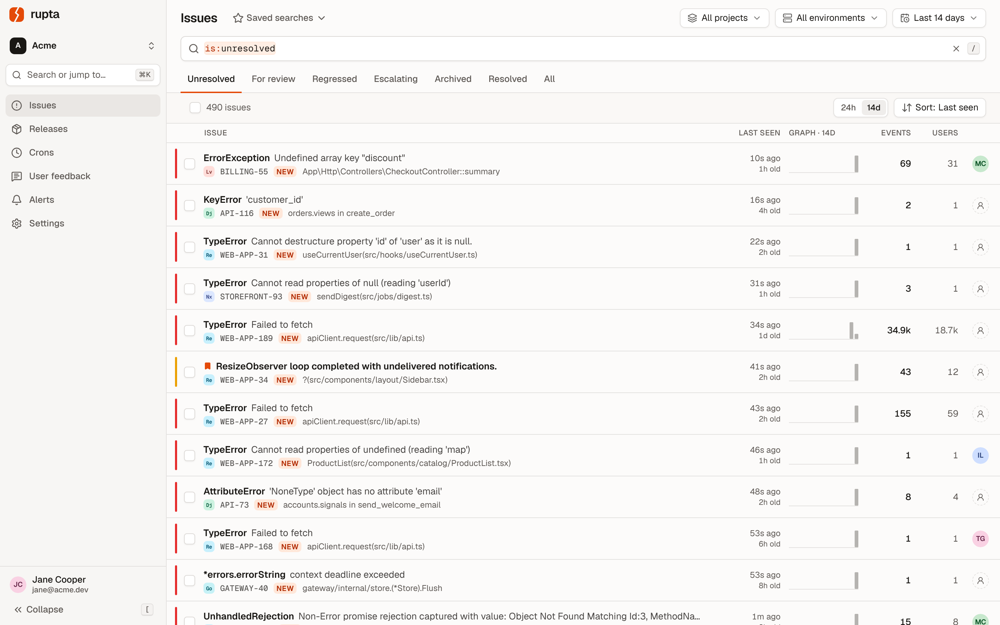
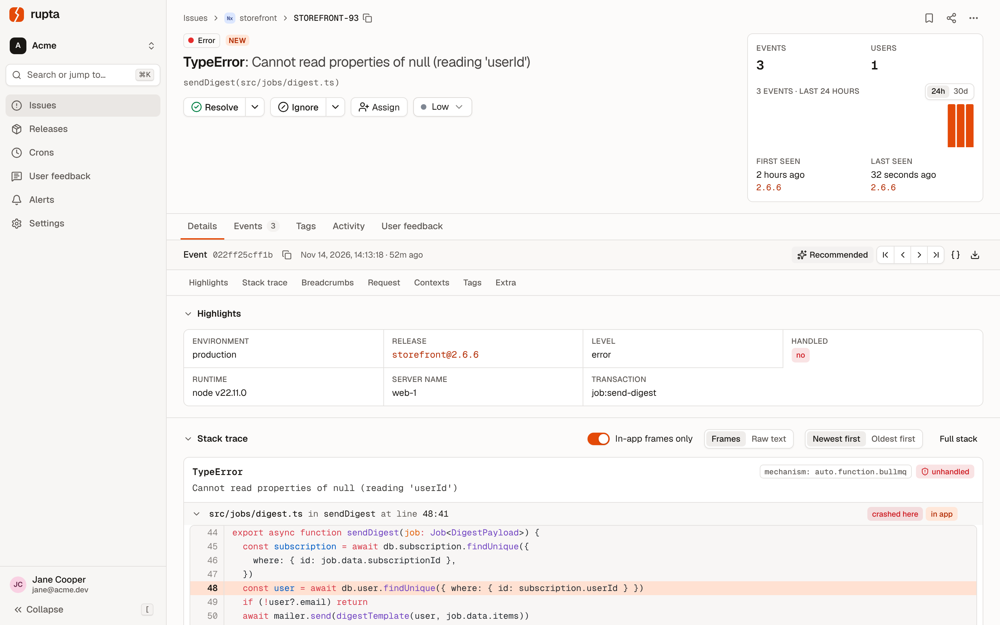
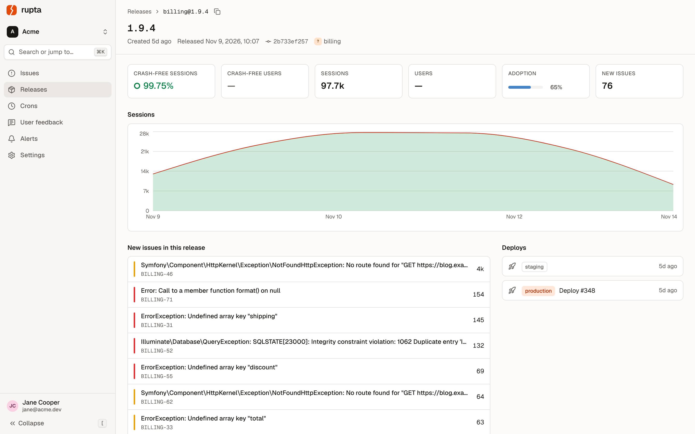
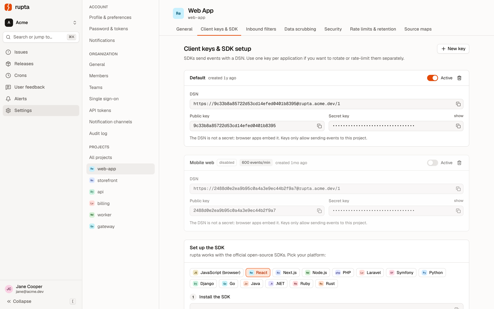
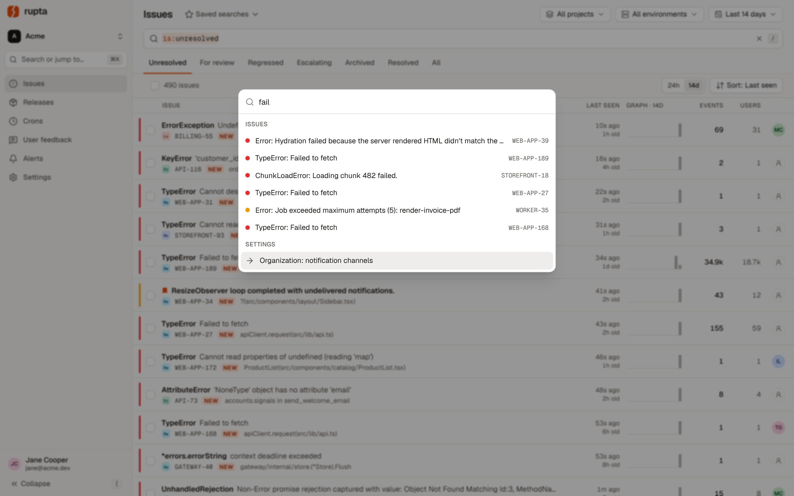

# User guide

A tour of the rupta web app: where things are, how to triage issues
quickly, the search syntax and the keyboard shortcuts.

## Signing in

- **First start.** When the database has no users and no bootstrap
  administrator is configured, the app opens a setup wizard: your account
  (name, email, password of at least 10 characters), then the name of your
  organization.
- **Sign in.** The login page offers email and password (unless the server
  disables it) and a button for each single sign-on provider the server
  lists. If an organization requires single sign-on, signing in with a
  password sends you to its provider instead. Add `?org=<slug>` to the
  login URL to see an organization's own provider.
- **Invitations.** Invitation links open `/accept-invite/<token>`. New
  people choose a name and password; people who already have an account
  accept while signed in. When the server cannot send email, the person
  who invited gets the link to pass on.

## Layout

The sidebar holds the organization switcher, a search field for the
command palette and the main sections: **Issues**, **Releases**, **Crons**,
**User feedback**, **Alerts** and **Settings**. At the bottom are your
account menu (theme, shortcuts, sign out) and a button to collapse the
sidebar (`[`). On small screens the sidebar opens from the menu button.

List pages share three selectors at the top: **projects**, **environments**
and **period**. They are part of the URL, so a link you copy opens the same
view, and they stay set while you move between pages.

## Issues

The stream lists issues grouped from events. Each row shows the level
(coloured bar), the error type and message, the project, the short id, a
status badge (New, Regressed, Escalating, Resolved, Ignored), the culprit,
when it was last and first seen, a bar chart of events over the selected
period, the event and user counts, and the assignee.

- **Tabs** switch the status part of the search: Unresolved, For review
  (new, untriaged issues), Regressed, Escalating, Archived (ignored),
  Resolved and All.
- **Period.** The period selector (or the 24h/14d switch above the list)
  limits the list to issues seen in that period and sets the range of the
  row charts: hourly bars up to 48 hours, daily bars beyond.
- **Sort** by last seen, first seen, events, users or priority.
- **Saved searches** keep a query and sort under a name, for you or shared
  with the organization.
- **Bulk actions.** Select rows with the checkboxes (shift-click selects a
  range) to resolve, ignore (until it escalates, forever, for a time, or
  until it happens a number of times again), assign, bookmark, mark
  reviewed or delete them. Changes show immediately and are undone if the
  server refuses them; resolving and ignoring offer **Undo** in the
  notification.
- **Live updates.** While the page is visible it checks for changes every
  30 seconds. Counts and charts of the listed issues update in place; when
  new issues arrive, a bar above the list offers to show them, so the list
  never jumps while you work.

The list is virtualised: only the visible rows exist in the page, so it
stays fast with tens of thousands of issues. More rows load as you scroll.

"Resolve in the next release" is offered, but the server has no marker
for the next release yet: the issue is resolved now.

## Issue details

The header shows level, status, title and culprit, buttons to resolve,
ignore, assign and set the priority, a bookmark, a link to copy and a menu
(copy as text or Markdown, delete). The box on the right has the event and
user counts, a chart of the last 24 hours or 30 days and the first and last
seen times with their releases.

Below are tabs:

- **Details** shows one event. Move between events with the arrows
  (oldest, previous, next, latest) or pick the recommended event. The event
  id can be copied; the JSON of the event can be viewed or downloaded.
  The sections, each linkable with `#name`:
  - **Highlights:** environment, release, level, handled, browser, OS,
    device, runtime, server, transaction, URL and user. Click a value to
    search issues with it. Problems during processing (for example a source
    file that could not be fetched) are listed here.
  - **Stack trace:** one block per exception, chained exceptions marked
    "Caused by". Frames from your code are shown; library frames are
    collapsed ("3 library frames hidden") unless you turn off **In-app
    frames only** or press **Full stack**. The frame where the error
    happened is open, with the source around the line (highlighted) and the
    local variables. Frames mapped with a source map are marked; the
    **Minified** view shows the original location, **Raw text** a copyable
    trace in the style of the platform. **Newest first / Oldest first**
    changes the order of frames and exceptions. Each frame has a link to
    copy.
  - **Breadcrumbs:** what happened before the error (navigation, HTTP
    requests with status, clicks, console and log messages, queries),
    newest first, with search, filters by type and level, and relative or
    absolute times.
  - **Request:** method and URL, query string, body, headers and cookies,
    and a button that copies the request as a cURL command.
  - **Contexts:** user, browser, operating system, device, runtime, app,
    trace and culture as cards.
  - **Tags**, **Additional data**, **Attachments**, **Packages** and
    **SDK**.
- **Events** lists the events of the issue and filters them with the
  event keys of the search language.
- **Tags** shows how values are distributed for each tag; a tag's page
  lists all its values.
- **Activity** has the history (first seen, assignments, status changes,
  regressions) and comments. Comments support Markdown; you can edit and
  delete your own.
- **User feedback** shows what users wrote about this error.

## Releases, crons, feedback and alerts

- **Releases** lists versions with new issues, crash-free sessions,
  adoption, session counts and the last deploy. A release's page charts
  sessions and crashes, lists the issues that first appeared in it and its
  deploys. Crash-free users are shown when the server provides them (it
  currently cannot derive them from session counts).
- **Crons** shows each monitor's schedule in words and a timeline of recent
  check-ins (ok, failed, missed, timed out). A monitor's page has the
  check-in history, success rate and average duration, and can disable the
  monitor.
- **User feedback** collects messages from the SDKs' feedback widgets and
  crash dialogs across the selected projects.
- **Alerts** lists the alert rules of the selected projects. A rule fires
  when **any** of its triggers holds (new issue, regression, an ignored
  issue reappears, more than N events or users in an interval) and **all**
  of its filters match (level, environment, tag), and then emails members
  or teams or notifies a channel, at most once per issue within the chosen
  time.

## Settings

- **Account:** name, theme (light, dark, system), timezone and 12/24-hour
  clock, password, personal API tokens and notification choices. Theme,
  timezone, clock and notification choices are saved in the browser; the
  server does not store them yet.
- **Organization:** name and slug, members and invitations with roles
  (owner, admin, member, viewer), teams, single sign-on, API tokens,
  notification channels (Slack, Microsoft Teams, email, webhook, each with
  a test button) and the audit log.
- **Single sign-on** connects an OpenID Connect provider. Presets fill in
  typical values (Zitadel, Keycloak, Microsoft Entra ID). Map role or group
  names from the ID token to rupta roles, choose a default role, whether
  accounts are created on first sign-in, whether single sign-on is
  required and whether owners keep password sign-in. The server checks the
  issuer when you save; the **Test connection** button checks it from the
  browser when the server has no test endpoint, which needs the provider to
  allow cross-origin requests.
- **API tokens** are shown once when created. Choose scopes and an
  expiry.
- **Projects:** each project has general settings, client keys (DSN) with
  setup instructions for the official open-source SDKs on 14 platforms,
  inbound filters, data scrubbing, allowed origins and the CSP report URI,
  rate limit and retention, and source maps with the upload CLI commands.

## Command palette

`⌘K` (or `Ctrl K`) opens the palette. Type to:

- go to any page or settings page,
- find issues by text, or jump to an issue by its short id (`WEB-12`),
- show only one project or open its settings,
- switch organization,
- switch the theme, or open the shortcut overview.

## Keyboard shortcuts

Single-key shortcuts work when no text field has focus. `?` shows them in
the app.

| Where | Keys | Action |
| --- | --- | --- |
| Everywhere | `⌘ K` | Command palette |
| | `?` | Shortcut overview |
| | `[` | Collapse or expand the sidebar |
| | `g` then `i` / `r` / `c` / `f` / `a` / `s` | Go to issues, releases, crons, feedback, alerts, settings |
| Issue stream | `/` | Focus the search |
| | `j` / `k` | Next / previous issue |
| | `x`, `shift x` | Select, select a range |
| | `Enter` or `o` | Open the issue |
| | `e` | Resolve |
| | `i` | Ignore until it escalates |
| | `u` | Mark unresolved |
| | `a` | Assign to me |
| | `b` | Bookmark |
| | `Esc` | Clear the selection |
| Issue details | `e` / `i` | Resolve or unresolve / ignore or unignore |
| | `a` / `b` | Assign to me / bookmark |
| | `h` / `l` | Previous / next event |
| | `shift h` / `shift l` | Oldest / latest event |
| | `c` | Copy the short id |
| | `Esc` | Back to the stream |

Actions in the stream apply to the selected issues, or to the highlighted
one when nothing is selected.

## Search syntax

The search bar colours filters as you type and suggests keys and values:
`↑`/`↓` choose, `Tab` completes, `Enter` searches. Terms are separated by
spaces and all must match. The full reference is [search](search.md).

| Form | Example |
| --- | --- |
| Free text | `timeout`, `"connection reset"` |
| Filter | `level:error`, `os:"Windows 11"` |
| Any of | `level:[error,fatal]` |
| Wildcard | `url:*checkout*` |
| Negation | `!environment:staging` |
| Comparison | `times_seen:>100`, `users_seen:>=10` |
| Age | `first_seen:-24h` (within 24 hours), `last_seen:+7d` (more than 7 days ago) |

Common keys: `is:` (unresolved, resolved, ignored, new, ongoing, regressed,
escalating, assigned, unassigned, bookmarked, unseen), `assigned:` (me,
none, an email, `#team`), `level:`, `priority:`, `release:`,
`first_release:`, `environment:`, `browser:`, `os:`, `device:`, `runtime:`,
`url:`, `transaction:`, `user.email:`, `error.type:`, `error.value:`,
`has:` and any tag (`region:eu-west` or `tags[region]:eu-west`). Value
suggestions come from the last 30 days of events for the event attributes;
custom tags are not suggested yet.

## Limits

- The web app needs a current browser (it uses modern JavaScript and CSS;
  no support for Internet Explorer).
- Times use your browser's timezone unless you choose another one in your
  account settings; that choice is per browser.
- Jumping to an issue by short id from the command palette needs a lookup
  endpoint the server does not have yet; searching for the issue's text
  works.
- The list of uploaded source map bundles needs a server endpoint that
  does not exist yet; uploads work regardless.
